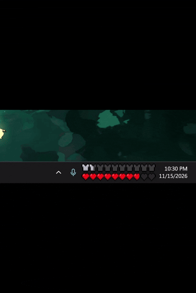

# Taskbar Hearts



Your laptop battery as Minecraft hearts, right on the Windows 11 taskbar.
<!-- Add a screenshot or GIF here, e.g.  -->

Hearts show your battery, armor shows free RAM, and hunger shows how busy your CPU is. Hover over
them and you get a little Minecraft-style HUD with the exact numbers, plus a hotbar full of extra
stats.

**[Download the latest version](../../releases/latest)** · Windows 11 (Windows 10 experimental) · free and open source

## What it does

- **Bars on your taskbar.** Pick one of three spots: a compact heart/hunger/armor trio on the
  battery icon, two rows of bars next to the tray, or bars that take over the battery spot itself.
- **Choose your bars.** Hearts + Armor, Hearts only, Hearts + Hunger, or Armor + Hunger, and pick
  what each icon shows in Advanced settings: hearts, hunger, armor and the XP bar can each be the
  battery, CPU, RAM or GPU (handy on a desktop PC with no battery).
- **A hover HUD.** Either a simple list, or one laid out like the real game: hearts, armor,
  hunger, your GPU as the XP bar, and a hotbar showing:

  | Item | Shows |
  | --- | --- |
  | Sugar / Firework rocket | Download and upload speed |
  | Diamond pickaxe | Free space on C: (durability bar) |
  | Clock | Uptime in hours |
  | Elytra | Battery health (durability bar) |
  | Redstone | Running processes |
  | Bundle | How full your other drives are |
  | Flint and steel | What's using the most CPU (drops as it burns more) |
  | Music disc | Volume |

  Hover anything for the exact numbers. Click the HUD to keep it open; click anywhere else to close it.
- **Custom hotbar.** Rather have a diamond sword and a golden apple than network stats? Turn on
  *Custom hotbar*, then click *Choose items* to pick from every item in your Minecraft install.
  Click or drag items into any slot, middle-click for a full stack like in creative, and
  right-click to remove. It's purely for looks.
- **Animations, like in the game.** Hearts shake when your battery is low, the hunger bar jitters
  when your CPU is maxed out, and while charging the hearts do the Regeneration wave. You can turn
  these off in the app.
- **Real game textures and font** come from your own Minecraft Java install. No Minecraft, or only
  Bedrock? It uses its own pixel art instead.

## Getting started

1. Download `TaskbarHearts.exe` from [Releases](../../releases/latest) and run it. There's
   nothing to install.
2. If Windows says *"Windows protected your PC"*, click **More info → Run anyway**. That happens
   because the app isn't code-signed; the full source is right here.
3. The settings window opens. Pick a layout and you're done. Right-click its taskbar button and
   choose **Pin to taskbar** to open it again any time. Closing the window keeps the hearts running;
   use **Quit** to stop the app. A crafting-table icon under **^** in the tray opens it too.

## Good to know

- It doesn't go online, collect anything, or need admin rights. It uses around 10 MB of memory.
- It sits on top of the battery icon rather than removing it; Windows doesn't let apps hide it.
- If your taskbar is transparent (TranslucentTB and similar), the **Bars** layout looks best.
- Works with right-to-left Windows languages (Arabic, Hebrew), where the taskbar is mirrored.
- Settings live in `%LOCALAPPDATA%\TaskbarHearts`.
- **Windows 10 (experimental):** the Compact and Bars layouts should work; Battery spot needs
  Windows 11. If the icons sit in the wrong place, use *Alignment Mode* in Advanced settings, and
  please send a Copy diagnostics report so it can be fixed.
- **Uninstall:** Exit from the tray menu, then delete the exe and that settings folder. If you
  turned on *Start with Windows*, turn it off first.

## Something looks wrong?

Open the app, click **Copy diagnostics**, and paste it into a new issue. It tells me your Windows
version and taskbar setup, without your name or any folder paths.

## Building it yourself

You'll need the [.NET 10 SDK](https://dotnet.microsoft.com/download).

```
dotnet run --project tests\SurvivalHud.Tests -c Release
dotnet publish src\SurvivalHud -c Release -o publish
```

## Credits

Built with help from Claude (Anthropic).

Minecraft is a trademark of Mojang. This is an unofficial fan project, not affiliated with Mojang
or Microsoft, and it doesn't include any Minecraft files.

## License

MIT, see [LICENSE](LICENSE).
